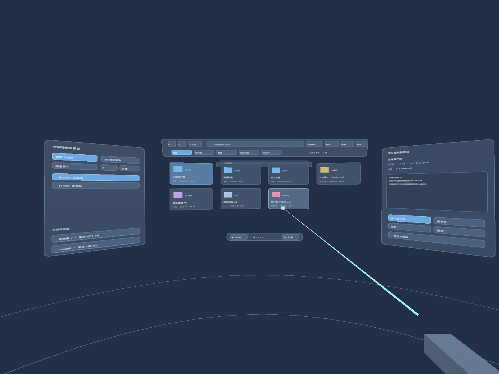
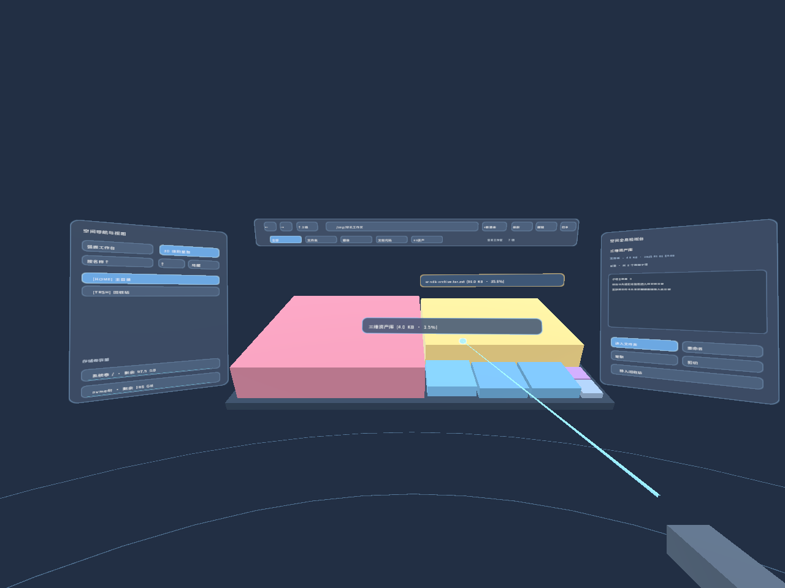

# 空间文件 (xr-files)

openKylin XR 的原生三维空间文件管理器，用于替代传统 2D 平面文件管理器（如 Peony）。基于 **Rust + wgpu (Vulkan / WGSL) + 跨架构硬件 SIMD** 构建，支持原生 OpenXR 双目立体会话、HyperSpace 空间桌面 Wayland 窗口协同以及无头离屏立体校验模式。





## 核心架构与空间特性

1. **双空间视图一键切换**
   - **环绕弧面景深工作台 (`Workbench`)**：围绕用户水平视线与双目中点（`Roll = 0°`，俯仰舒适区 `[-25°, +10°]`）展开三岛弧面布局：
     - **左翼空间导航岛 (`+34.5°`)**：常用 XDG 目录书签、回收站（`trash://`）、`statvfs` 实时挂载卷容量仪表、排序与视图切换。
     - **中央曲面体积文件矩阵 + Z 轴目录景深栈 (`0°`)**：父级目录沿 Z 轴向远处递退形成空间层级走廊；文件卡片具备真实三维厚度、类型色标、异步缩略图，以及遵循空间规范的三态深度行程（静态 `+8mm`、悬停 `+18mm`、按压 `+2mm`）。
     - **右翼全息检视预览台 (`-34.5°`)**：实时旋转立体渲染 `.obj` / `.stl` / `.glb` 三维模型全息图、高分辨率多级 Mipmap 图片预览、代码文本/十六进制采样、信息熵谱条，以及视频一键交由 `xr-cinema`（空间影院）播放。
   - **3D 空间体积星图 (`Treemap3D`)**：采用 Squarified 面积剖分与对数高度挤出，在倾斜 22° 的立体沙盘上直观呈现目录存储热点。

2. **跨平台硬件 SIMD 加速 (`src/simd.rs`)**
   - 自动按目标架构启用 `x86_64` **AVX2 / SSE2**、`aarch64` **NEON**，并提供 `riscv64` 精确标量回退：
     - **SoA 三维射线包围盒批量求交 (`SoaAabbBatch`)**：8 路/4 路并行求交，内置 `2.2°` 远场动态热区容差，并严格遵循 `AUDIT-01` 同平面真实几何命中绝对优先于扩展热区。
     - **SIMD 大小写折叠子串与边界模糊匹配**：极速过滤与排序海量目录条目。
     - **SIMD 图像 2×2 Box 降采样与预乘 Alpha 转换**：在 CPU 侧无损生成缩略图与 CJK 字形图集的完整 Mipmap 链，配合 GPU 线性三线性与各向异性采样消除转头高频闪烁。
     - **SIMD 字节流扫描与香农信息熵**：并行统计换行符、NUL 二进制特征与 4 路展开直方图熵值。

3. **完整文件管理闭环与 6DoF 双手交互**
   - 支持新建文件夹、重命名、多选、复制/剪切/粘贴（自动防覆盖命名）、符合 FreeDesktop Trash 1.0 标准的回收站移入与原位还原，以及全操作可逆撤销栈（`Undo`）。
   - 支持双手独立 6DoF 射线、施密特双阈值防抖（扳机 `0.65/0.35`、抓握 `0.60/0.35`）、空间双击坐标稳定器（`40..450ms`、`≤ 1.6°`）、抓握键（Squeeze）三维卡片拖拽投递与工作台环绕推拉、A/X 键（或长按扳机）悬浮快捷菜单及分级触觉反馈。

## 构建、测试与打包

构建无需外部 `glslangValidator` 或 Cairo/Pango 头依赖（纯 Rust WGSL + `ab_glyph` 字形光栅）：

```sh
cargo test --locked
cargo build --release --locked
sh packaging/package.sh "xr-files_0.1.0_$(dpkg --print-architecture).deb" target/release/xr-files
```

通过 `xr-image-tools` 锁定提交构建安装包：

```sh
python3 ../xr-image-tools/tools/components.py build --profile files --output /tmp/xr-files-build --only xr-files
```

## 运行与智能控制接口 v1

```sh
xr-files                          # 自动检测 OpenXR 头显会话或回退至桌面窗口模式
xr-files --xr ~/Documents         # 强制以原生 OpenXR 立体空间模式打开目录
xr-files --window --treemap ~     # 在桌面/xr-wayland 窗口中打开 3D 体积星图
xr-files --headless --capture-dir /tmp/xr-files-cap
```

运行期间提供本地控制 socket `$XDG_RUNTIME_DIR/xr-files/control.sock`（权限 `0600`）：

```sh
xr-files ctl '{"op":"status"}'
xr-files ctl '{"op":"search","query":"openkylin"}'
xr-files ctl '{"op":"set_view","view":"treemap3d"}'
xr-files ctl '{"op":"mkdir","name":"空间工作区"}'
xr-files ctl '{"op":"undo"}'
xr-files ctl '{"op":"quit"}'
```
